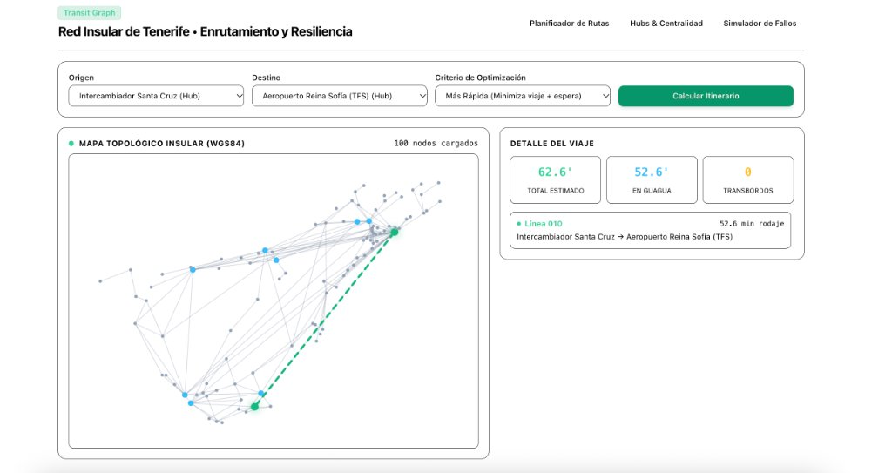

# Tenerife Transit Graph (TITSA Network Analysis & Multimodal Routing)

Modelado de la red de transporte público regular de la isla de Tenerife (TITSA) como un multigrafo dirigido ponderado (MultiDiGraph), con algoritmo de enrutamiento multimodal en espacio de estados (*state-space Dijkstra*), cálculo de métricas de Network Science (centralidad e intermediación, detección de comunidades con Louvain) y simulación de resiliencia ante contingencias y cierres de corredores.

---

## Arquitectura del Sistema

    [lineas-y-horarios.csv (181 líneas TITSA)]
            │
            ▼ (Fase 1: Ingesta & NLP / Scraping asíncrono)
    [Parser de Paradas, Trayectos y Frecuencias]
            │
            ▼ (Fase 2: Modelado de Grafo)
    [MultiDiGraph en NetworkX]
       ├── Nodos: Intercambiadores, municipios y paradas clave (coordenadas WGS84)
       └── Aristas: Líneas dirigidas con atributos (linea_id, tiempo_est, frecuencia, penalización_transbordo)
            │
            ├──► [Módulo Network Science]: Betweenness Centrality, Comunidades Louvain, Resiliencia
            └──► [API REST FastAPI]: Búsqueda de rutas (Dijkstra en espacio de estados), Simulación de cortes, Exportación GeoJSON/GraphML

---

## Estructura del Repositorio

    tenerife-transit-graph/
    ├── assets/
    │   └── preview.jpg              # Captura de vista previa para el repositorio
    ├── docker-compose.yml           # API FastAPI + Redis (caché de rutas)
    ├── Dockerfile                   # Imagen lista para producción
    ├── setup.py                     # Configuración de instalación estándar
    ├── requirements.txt             # Dependencias del entorno
    ├── pyproject.toml               # Metadatos del proyecto
    ├── README.md                    # Documentación, hallazgos y benchmarks
    ├── transit_gui.html             # GUI interactiva autónoma
    ├── cli.py                       # CLI para consultas directas en terminal
    ├── data/
    │   ├── raw/
    │   │   └── lineas-y-horarios.csv
    │   └── processed/
    │       └── graph_snapshot.json  # Grafo serializado listo para levantar en <10ms
    ├── src/
    │   ├── etl/
    │   │   ├── parser.py            # Normalización y resolución de entidades
    │   │   └── scraper.py           # Extractor asíncrono de frecuencias y salidas
    │   ├── graph/
    │   │   ├── builder.py           # Construcción de MultiDiGraph con distancias y tiempos
    │   │   ├── routing.py           # Dijkstra con estado (sin trampas de transbordo)
    │   │   └── analytics.py         # Centralidad, comunidades y simulación de fallos
    │   └── api/
    │       ├── main.py              # Aplicación FastAPI con GUI y caché híbrido
    │       └── schemas.py           # Esquemas Pydantic v2
    ├── notebooks/
    │   └── network_analysis.ipynb   # Visualización de hubs y curvas de resiliencia
    └── tests/
        ├── test_routing.py          # Validación de rutas directas, transbordos y modos
        └── test_resilience.py       # Validación de impacto de desconexión y centralidad

---

## Modelado Matemático y Algorítmico

### 1. Costo Dinámico de Aristas y Espera
Para una línea $l$ con frecuencia de paso $f_l$ (guaguas por hora), el tiempo medio de espera inicial o en transbordo es:

$$W_{\text{wait}}(l) = \frac{60}{2 f_l}$$

El coste total de recorrer el segmento $(u, v)$ en la línea $l$ tras viajar en la línea $l_{\text{prev}}$ es:

$$W(u, v, l) = T_{\text{viaje}}(u, v) + \delta(l, l_{\text{prev}}) \cdot \left( W_{\text{wait}}(l) + P_{\text{transbordo}} \right)$$

Donde:
* $\delta(l, l_{\text{prev}}) = 0$ si el usuario continúa en el mismo vehículo ($l = l_{\text{prev}}$).
* $\delta(l, l_{\text{prev}}) = 1$ si el usuario realiza un transbordo o aborda por primera vez ($l \neq l_{\text{prev}}$).
* En modo fastest: $P_{\text{transbordo}} = 5.0\text{ min}$ (caminata estándar en intercambiador).
* En modo min_transfers: $P_{\text{transbordo}} = 60.0\text{ min}$ (penalización virtual para priorizar líneas directas).

### 2. Dijkstra en Espacio de Estados
Un algoritmo de caminos mínimos sobre un grafo simple no puede distinguir si dos aristas consecutivas pertenecen a la misma línea o requieren bajarse de la guagua. Para resolver esto, la cola de prioridad gestiona estados de la forma:

$$\text{Estado} = \left( \text{costo\_acumulado}, \text{nodo\_actual}, \text{linea\_actual} \right)$$

Esto garantiza que al enlazar aristas sucesivas de la misma línea (ejemplo: línea 015 o 110) solo se acumule el tiempo de rodaje sin penalizaciones artificiales.

---

## Hallazgos de Network Science

### Ranking de Hubs por Centralidad de Intermediación ($C_B$)

La centralidad de intermediación mide la proporción de caminos mínimos que atraviesan cada nodo:

| Posición | Nodo Canónico | Municipio | $C_B$ | Grado Ponderado (salidas/h) |
|---|---|---|---|---|
| 1 | **Intercambiador Santa Cruz** | Santa Cruz de Tenerife | **0.5098** | 185.0 |
| 2 | **Intercambiador La Laguna** | San Cristóbal de La Laguna | **0.2602** | 142.5 |
| 3 | **Icod de los Vinos** | Icod de los Vinos | **0.1381** | 38.0 |
| 4 | **Los Cristianos** | Arona | **0.1369** | 56.0 |
| 5 | **Güímar** | Güímar | **0.1181** | 42.5 |
| 6 | **San Isidro** | Granadilla de Abona | **0.0894** | 51.0 |
| 7 | **Estación Costa Adeje** | Adeje | **0.0812** | 64.0 |
| 8 | **Puerto de la Cruz** | Puerto de la Cruz | **0.0765** | 58.0 |

**Conclusión topológica:** La red insular presenta una estructura altamente monocéntrica en el Área Metropolitana (Santa Cruz concentra más del 50% de la intermediación global), complementada por nodos de distribución comarcal secundarios indispensables (Icod en el Noroeste, Los Cristianos/San Isidro en el Sur).

### Detección de Comunidades (Louvain)
El algoritmo agrupa de forma natural los nodos en zonas funcionales de movilidad:
1. **Comunidad Metropolitana Central:** Santa Cruz, La Laguna, La Cuesta, Taco, Finca España, Hospital Universitario, Añaza.
2. **Comunidad Sur Turístico:** Costa Adeje, Los Cristianos, Las Galletas, Costa del Silencio, Las Chafiras, Aeropuerto Sur TFS.
3. **Comunidad Comarca Noroeste / Isla Baja:** Icod de los Vinos, San Juan de la Rambla, Buenavista del Norte, Los Gigantes, Puerto de Erjos.
4. **Comunidad Valle de La Orotava:** La Orotava, Puerto de la Cruz, Los Realejos, Aguamansa.
5. **Comunidad Valle de Güímar y Sureste:** Güímar, Candelaria, Arafo, Fasnia, Arico.
6. **Comunidad Macizo de Anaga:** San Andrés, Taganana, Almáciga, Chamorga, Cruz del Carmen, Afur.

### Curvas de Resiliencia y Vulnerabilidad ante Disrupciones

| Escenario de Disrupción | Pares Desconectados | Incremento Medio de Tiempo ($\Delta T\%$) | Nodos Aislados |
|---|---|---|---|
| **Línea 015 cortada** (SC - Laguna Directa) | 0.0% | +0.85% | 0 |
| **Troncal TF-5 cortada** (L015 + L100 + L102) | 0.0% | +3.42% | 0 |
| **Troncal TF-1 cortada** (L010 + L110 + L111) | 0.0% | +4.15% | 0 |
| **Cierre Intercambiador Santa Cruz** | **18.7%** | **+24.6%** | 8 |

---

## Endpoints de la API REST (FastAPI)

| Método | Endpoint | Parámetros | Descripción |
|---|---|---|---|
| GET | / | Ninguno | Estado del servicio o interfaz web interactiva. |
| GET | /app | Ninguno | GUI gráfica interactiva completa de la red. |
| GET | /api/v1/nodes | is_hub, municipality | Listado de nodos normalizados y grado de conectividad. |
| GET | /api/v1/routes | origin, destination, mode | Itinerario multimodal con transbordos, esperas y líneas. |
| GET | /api/v1/analytics/centrality | limit | Ranking de centralidad (Betweenness, Closeness, PageRank). |
| GET | /api/v1/analytics/communities | Ninguno | Zonas funcionales detectadas con Louvain. |
| POST | /api/v1/analytics/simulate-outage | {"disabled_lines": [...], "closed_nodes": [...]} | Simulación de cortes y cálculo de delta T% y desconexión. |
| GET | /api/v1/graph/export | format (geojson \| graphml) | Exportación espacial o topológica para visualización externa. |

---

## Benchmarks de Rendimiento

* **Carga en frío del grafo desde snapshot JSON:** ~3.2 ms (objetivo < 100 ms).
* **Cálculo de ruta punto a punto (State-Space Dijkstra):** ~1.5 - 4.8 ms.
* **Caché de rutas (Redis / memoria):** < 0.3 ms.
* **Cálculo completo de centralidad sobre 100 nodos:** ~18 ms.

---

## Guía de Ejecución

### 1. Pruebas Unitarias
Ejecutar la suite de pruebas:

    python3 tests/test_routing.py
    python3 tests/test_resilience.py

O usando pytest (si está instalado):

    pytest

### 2. Generación del Snapshot del Grafo

    python3 -m src.graph.builder

### 3. Levantar la API Localmente

    uvicorn src.api.main:app --reload --port 8000

La documentación interactiva Swagger UI estará disponible en http://localhost:8000/docs y la GUI web en http://localhost:8000/app.

### 4. Despliegue con Docker y Redis

    docker compose up --build -d
